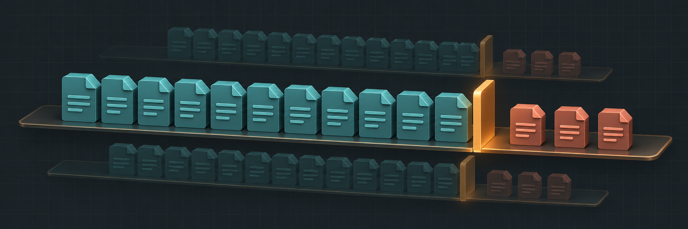
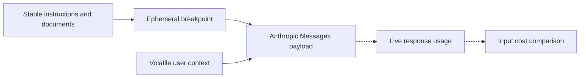

# Prompt Cache Router



**Can a stable prompt prefix reduce input costs when every request carries different user context?** A local replication starter for Anthropic’s explicit prompt cache breakpoints.

**Python 3.10+** · **Offline request builder** · **Synthetic usage demo**

[Quick start](#quick-start) · [Cache boundary](#cache-boundary) · [Live replication plan](#live-replication-plan)

## Quick start

```sh
python cache_router.py
```

The demo builds two request bodies with the same system context and different user messages. It then prices one example cache write and one example cache read against an uncached baseline.

| Example metric | Value |
| --- | ---: |
| Tokens read from cache | 2,400 |
| Estimated uncached input cost | $0.015030 |
| Estimated cache-adjusted input cost | $0.010350 |
| Estimated input savings | $0.004680 |

These are synthetic usage records and illustrative rates. The calculator excludes output costs and takes the model’s input price and cache multipliers as parameters.

## Cache boundary



The builder takes static and volatile fields separately. It preserves block order and puts the breakpoint on the final stable block. Keep tools, model settings, and the whole prefix stable across paired calls. Cacheability also depends on the model’s minimum prefix length and the cache TTL. [Anthropic prompt caching documentation](https://platform.claude.com/docs/en/build-with-claude/prompt-caching)

## Live replication plan

1. Add the gateway and forward structured requests to the Anthropic Messages API.
2. Run a cold request, repeat with only the user suffix changed, then change one prefix field as a control. Keep the prefix above the model’s minimum cacheable length.
3. Collect cache-write tokens, cache-read tokens and ordinary input tokens from real responses. Chart read rates and estimated input cost per run using the selected model’s [published rates](https://platform.claude.com/docs/en/about-claude/pricing).

- [Request builder and cost calculator](cache_router.py)
